<!--
  Perfil de GitHub de Zemog Gómez Tabares.
  Los textos de las imágenes viven en content/profile.toml.
  Para regenerar los SVG: python3 scripts/build_assets.py
-->

<a href="https://zemzystem.com">
  <picture>
    <source media="(prefers-color-scheme: dark)" srcset="assets/hero-dark.svg">
    <source media="(prefers-color-scheme: light)" srcset="assets/hero-light.svg">
    
  </picture>
</a>

  

<picture>
  <source media="(prefers-color-scheme: dark)" srcset="assets/sections/about-dark.svg">
  <source media="(prefers-color-scheme: light)" srcset="assets/sections/about-light.svg">
  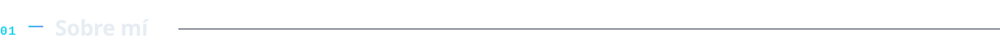
</picture>

Soy fundador y CEO de **[ZemZysteM](https://zemzystem.com)**, empresa de tecnología, y desarrollador de software con más de 4 años de experiencia. Llevo los productos de punta a punta: modelo de dominio, APIs, interfaces, despliegue y operación en producción.

Trabajo con **arquitectura hexagonal** y **monolitos modulares**, construyo **SaaS multi-tenant** con aislamiento estricto entre clientes y automatizo procesos con **RPA** y **agentes digitales** supervisados por personas. Cada decisión técnica queda documentada, probada y desplegada con CI/CD.

<picture>
  <source media="(prefers-color-scheme: dark)" srcset="assets/about-dark.svg">
  <source media="(prefers-color-scheme: light)" srcset="assets/about-light.svg">
  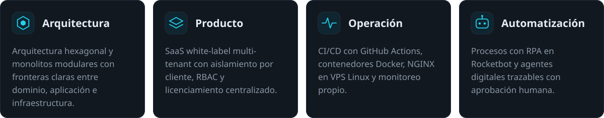
</picture>

  

<picture>
  <source media="(prefers-color-scheme: dark)" srcset="assets/sections/stack-dark.svg">
  <source media="(prefers-color-scheme: light)" srcset="assets/sections/stack-light.svg">
  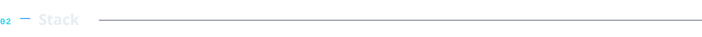
</picture>

<picture>
  <source media="(prefers-color-scheme: dark)" srcset="assets/stack-dark.svg">
  <source media="(prefers-color-scheme: light)" srcset="assets/stack-light.svg">
  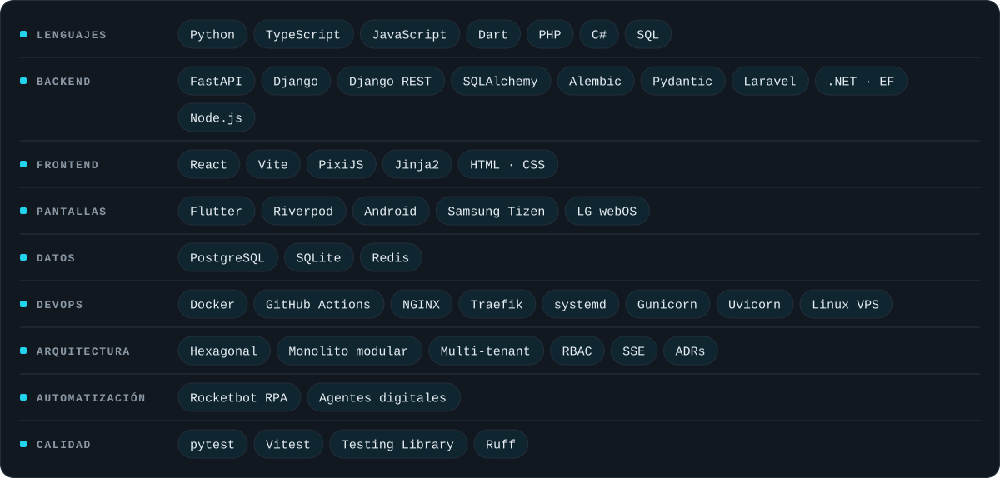
</picture>

  

<picture>
  <source media="(prefers-color-scheme: dark)" srcset="assets/sections/projects-dark.svg">
  <source media="(prefers-color-scheme: light)" srcset="assets/sections/projects-light.svg">
  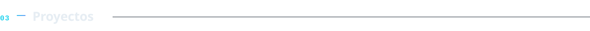
</picture>

Productos que diseño y desarrollo en ZemZysteM. El código es privado porque sirve a clientes reales; los detalles técnicos están disponibles bajo conversación.

  <picture>
    <source media="(prefers-color-scheme: dark)" srcset="assets/projects/zystemmedia-dark.svg">
    <source media="(prefers-color-scheme: light)" srcset="assets/projects/zystemmedia-light.svg">
    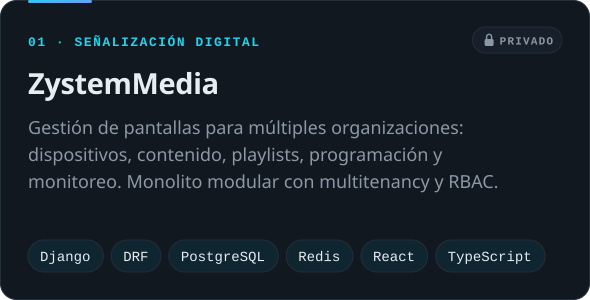
  </picture>
  <picture>
    <source media="(prefers-color-scheme: dark)" srcset="assets/projects/players-dark.svg">
    <source media="(prefers-color-scheme: light)" srcset="assets/projects/players-light.svg">
    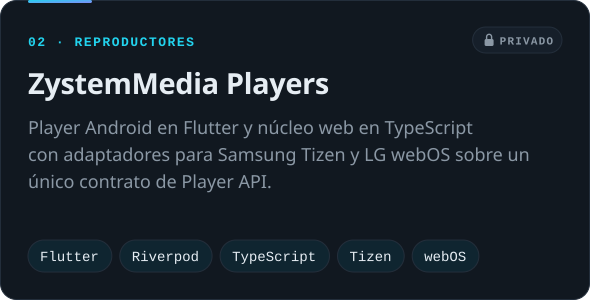
  </picture>

  <picture>
    <source media="(prefers-color-scheme: dark)" srcset="assets/projects/turnero-dark.svg">
    <source media="(prefers-color-scheme: light)" srcset="assets/projects/turnero-light.svg">
    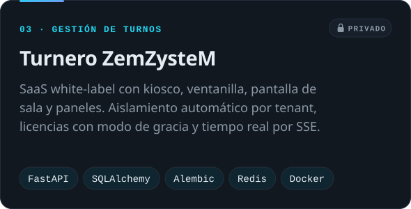
  </picture>
  <picture>
    <source media="(prefers-color-scheme: dark)" srcset="assets/projects/wayfinding-dark.svg">
    <source media="(prefers-color-scheme: light)" srcset="assets/projects/wayfinding-light.svg">
    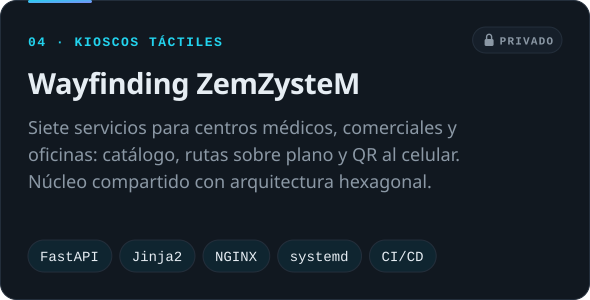
  </picture>

  <picture>
    <source media="(prefers-color-scheme: dark)" srcset="assets/projects/agent-office-dark.svg">
    <source media="(prefers-color-scheme: light)" srcset="assets/projects/agent-office-light.svg">
    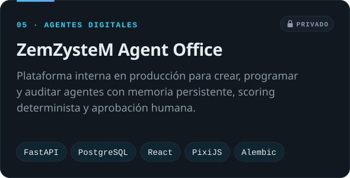
  </picture>
  <picture>
    <source media="(prefers-color-scheme: dark)" srcset="assets/projects/noc-dark.svg">
    <source media="(prefers-color-scheme: light)" srcset="assets/projects/noc-light.svg">
    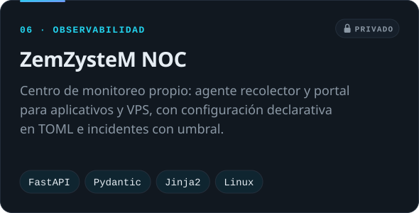
  </picture>

**Repositorios públicos**: [MicroCRM](https://github.com/zemogc/MicroCRM) · [Microservices_nodejs](https://github.com/zemogc/Microservices_nodejs) · [AnalisisDatosEps](https://github.com/zemogc/AnalisisDatosEps) · [LandingPageWAY](https://github.com/zemogc/LandingPageWAY) · [todos →](https://github.com/zemogc?tab=repositories&type=source)

 

<picture>
  <source media="(prefers-color-scheme: dark)" srcset="assets/sections/contact-dark.svg">
  <source media="(prefers-color-scheme: light)" srcset="assets/sections/contact-light.svg">
  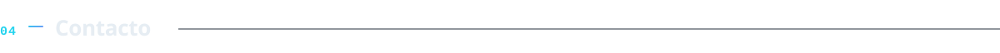
</picture>

  <a href="https://www.linkedin.com/in/zemog-g%C3%B3mez-tabares-8418a5296/">
    <picture>
      <source media="(prefers-color-scheme: dark)" srcset="assets/contact/linkedin-dark.svg">
      <source media="(prefers-color-scheme: light)" srcset="assets/contact/linkedin-light.svg">
      
    </picture>
  </a>
  <a href="https://zemzystem.com">
    <picture>
      <source media="(prefers-color-scheme: dark)" srcset="assets/contact/website-dark.svg">
      <source media="(prefers-color-scheme: light)" srcset="assets/contact/website-light.svg">
      
    </picture>
  </a>
  <a href="https://www.instagram.com/zemzystem/">
    <picture>
      <source media="(prefers-color-scheme: dark)" srcset="assets/contact/instagram-dark.svg">
      <source media="(prefers-color-scheme: light)" srcset="assets/contact/instagram-light.svg">
      
    </picture>
  </a>
  <a href="https://github.com/zemogc">
    <picture>
      <source media="(prefers-color-scheme: dark)" srcset="assets/contact/github-dark.svg">
      <source media="(prefers-color-scheme: light)" srcset="assets/contact/github-light.svg">
      
    </picture>
  </a>

<picture>
  <source media="(prefers-color-scheme: dark)" srcset="assets/footer-dark.svg">
  <source media="(prefers-color-scheme: light)" srcset="assets/footer-light.svg">
  
</picture>
