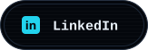
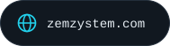
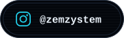

<!--
  Perfil de GitHub de Zemog Gómez Tabares · ZemZysteM.
  Textos: content/profile.toml · Datos en vivo: data/github.json (GitHub Actions)
  Regenerar: python3 scripts/build_assets.py
-->

<a href="https://zemzystem.com">
  <picture>
    <source media="(prefers-color-scheme: dark)" srcset="assets/hero-dark.svg">
    <source media="(prefers-color-scheme: light)" srcset="assets/hero-light.svg">
    
  </picture>
</a>

 

<picture>
  <source media="(prefers-color-scheme: dark)" srcset="assets/system-dark.svg">
  <source media="(prefers-color-scheme: light)" srcset="assets/system-light.svg">
  
</picture>

 

<picture>
  <source media="(prefers-color-scheme: dark)" srcset="assets/activity-dark.svg">
  <source media="(prefers-color-scheme: light)" srcset="assets/activity-light.svg">
  
</picture>

 

<picture>
  <source media="(prefers-color-scheme: dark)" srcset="assets/products-dark.svg">
  <source media="(prefers-color-scheme: light)" srcset="assets/products-light.svg">
  
</picture>

El código de los productos es privado porque sirve a clientes reales. Repositorios públicos: <a href="https://github.com/zemogc?tab=repositories&type=source">github.com/zemogc</a>

  <a href="https://www.linkedin.com/in/zemog-g%C3%B3mez-tabares-8418a5296/">
    <picture>
      <source media="(prefers-color-scheme: dark)" srcset="assets/contact/linkedin-dark.svg">
      <source media="(prefers-color-scheme: light)" srcset="assets/contact/linkedin-light.svg">
      
    </picture>
  </a>&nbsp;
  <a href="https://zemzystem.com">
    <picture>
      <source media="(prefers-color-scheme: dark)" srcset="assets/contact/website-dark.svg">
      <source media="(prefers-color-scheme: light)" srcset="assets/contact/website-light.svg">
      
    </picture>
  </a>&nbsp;
  <a href="https://www.instagram.com/zemzystem/">
    <picture>
      <source media="(prefers-color-scheme: dark)" srcset="assets/contact/instagram-dark.svg">
      <source media="(prefers-color-scheme: light)" srcset="assets/contact/instagram-light.svg">
      
    </picture>
  </a>

<picture>
  <source media="(prefers-color-scheme: dark)" srcset="assets/outro-dark.svg">
  <source media="(prefers-color-scheme: light)" srcset="assets/outro-light.svg">
  
</picture>
