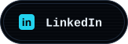
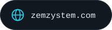
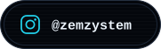

<!--
  Perfil de GitHub de Zemog Gómez Tabares · ZemZysteM.
  Textos: content/profile.toml · Datos en vivo: data/github.json (GitHub Actions)
  Regenerar: python3 scripts/build_assets.py
-->

<a href="https://zemzystem.com">
  <picture>
    <source media="(prefers-color-scheme: dark)" srcset="assets/hero-dark.svg">
    <source media="(prefers-color-scheme: light)" srcset="assets/hero-light.svg">
    
  </picture>
</a>

 

<picture>
  <source media="(prefers-color-scheme: dark)" srcset="assets/system-dark.svg">
  <source media="(prefers-color-scheme: light)" srcset="assets/system-light.svg">
  
</picture>

 

<picture>
  <source media="(prefers-color-scheme: dark)" srcset="assets/activity-dark.svg">
  <source media="(prefers-color-scheme: light)" srcset="assets/activity-light.svg">
  
</picture>

 

<picture>
  <source media="(prefers-color-scheme: dark)" srcset="assets/products-dark.svg">
  <source media="(prefers-color-scheme: light)" srcset="assets/products-light.svg">
  
</picture>

El código de los productos es privado porque sirve a clientes reales. Repositorios públicos: <a href="https://github.com/zemogc?tab=repositories&type=source">github.com/zemogc</a>

Resumen en texto

**Zemog Gómez Tabares** — Founder & CEO de [ZemZysteM](https://zemzystem.com), empresa de tecnología en Colombia. Software Developer con más de 4 años de experiencia: diseño y construyo plataformas SaaS multi-tenant, señalización digital y automatización.

**Productos**

- **ZystemMedia** (en producción) — señalización digital: pantallas, contenido, playlists y programación para múltiples organizaciones.
- **Wayfinding** (en producción) — kioscos táctiles con rutas sobre plano y QR al celular.
- **Agent Office** (en producción) — agentes digitales con memoria, scoring determinista y aprobación humana.
- **Turnero** (en desarrollo) — SaaS white-label de gestión de turnos: kiosco, ventanilla y pantalla de sala en tiempo real.
- **Players** (en desarrollo) — un contrato de Player API para Android, Samsung Tizen y LG webOS.
- **NOC** (en desarrollo) — monitoreo propio de aplicativos y VPS con incidentes por umbral.

**Stack**

- Lenguajes: Python, TypeScript, JavaScript, Dart, PHP, C#, SQL.
- Backend: FastAPI, Django, DRF, SQLAlchemy, Alembic, Laravel. Frontend: React, Vite, PixiJS, Jinja2.
- Pantallas: Flutter, Android, Samsung Tizen, LG webOS. Datos: PostgreSQL, SQLite, Redis.
- Infraestructura: Docker, NGINX, Traefik, systemd, GitHub Actions.
- Arquitectura: hexagonal, monolito modular, multi-tenant, RBAC. Automatización: Rocketbot RPA.

**Contacto:** [LinkedIn](https://www.linkedin.com/in/zemog-g%C3%B3mez-tabares-8418a5296/) · [zemzystem.com](https://zemzystem.com) · [Instagram @zemzystem](https://www.instagram.com/zemzystem/)

  <a href="https://www.linkedin.com/in/zemog-g%C3%B3mez-tabares-8418a5296/">
    <picture>
      <source media="(prefers-color-scheme: dark)" srcset="assets/contact/linkedin-dark.svg">
      <source media="(prefers-color-scheme: light)" srcset="assets/contact/linkedin-light.svg">
      
    </picture>
  </a>&nbsp;
  <a href="https://zemzystem.com">
    <picture>
      <source media="(prefers-color-scheme: dark)" srcset="assets/contact/website-dark.svg">
      <source media="(prefers-color-scheme: light)" srcset="assets/contact/website-light.svg">
      
    </picture>
  </a>&nbsp;
  <a href="https://www.instagram.com/zemzystem/">
    <picture>
      <source media="(prefers-color-scheme: dark)" srcset="assets/contact/instagram-dark.svg">
      <source media="(prefers-color-scheme: light)" srcset="assets/contact/instagram-light.svg">
      
    </picture>
  </a>

<picture>
  <source media="(prefers-color-scheme: dark)" srcset="assets/outro-dark.svg">
  <source media="(prefers-color-scheme: light)" srcset="assets/outro-light.svg">
  
</picture>
